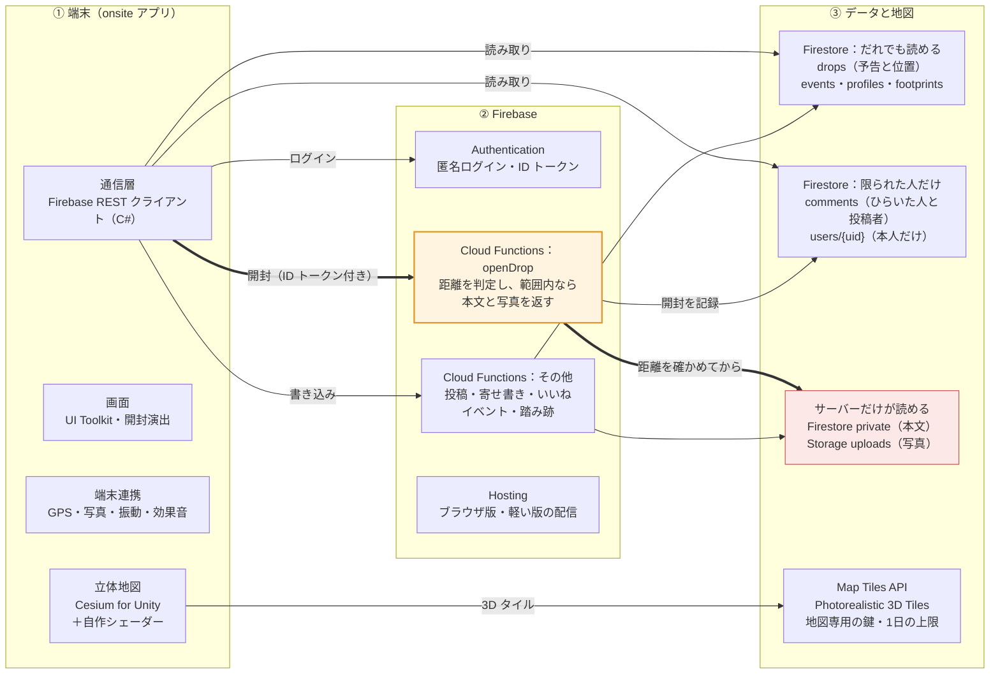
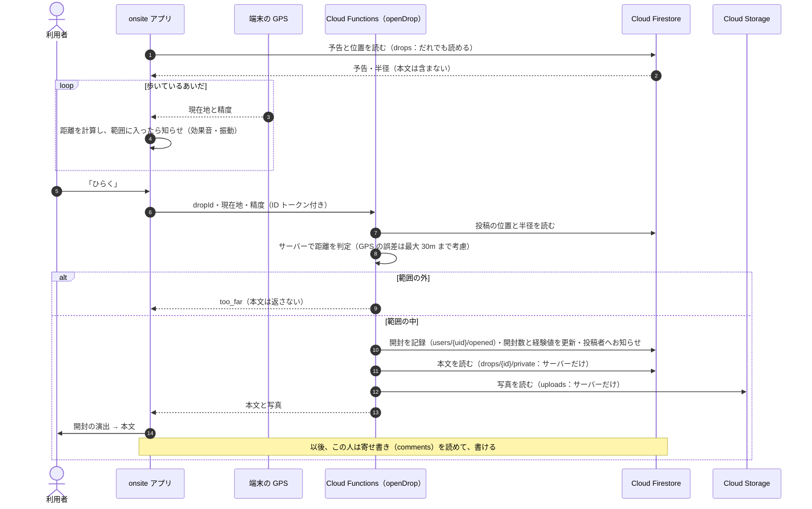

# onsite のアーキテクチャ

## 全体の構成

## 「ひらく」までの流れ

- 本文・写真・寄せ書きは、Firestore と Storage のセキュリティルールでアプリから直接は読めないようにしています。中身を返すのは、距離を確かめた Cloud Functions だけです。
- 書き込みはすべて Cloud Functions を通します（アプリからデータベースへ直接は書けません）。
- 現在地はサーバーに保存しません。開封したときの距離だけを、本人の記録に残します。
